<div align="center">


# Deloist Боты

**Команда ИИ-ботов на вашем компьютере**

Секретарь, аналитик, исследователь и помощник для Ozon и WB в одном окне.<br>
Разбирают почту, сверяют остатки и отвечают клиентам, а перед важным шагом спрашивают вас.

[](https://github.com/gordidima-rgb/deloist-agent/releases/latest)
[](https://github.com/gordidima-rgb/deloist-agent/releases/latest)
[](LICENSE)
[](#сколько-это-стоит)
[](#сборка-из-исходников)
[](https://t.me/deloist_app)

**[⬇ Скачать для Windows](https://github.com/gordidima-rgb/deloist-agent/releases/latest/download/Deloist-Setup.exe)** ·
[Сайт](https://deloist.ru) ·
[Что нового](https://github.com/gordidima-rgb/deloist-agent/releases) ·
[Сообщить об ошибке](../../issues/new?template=bug.yml) ·
[English](README.md)

</div>

<br>

<picture>
  <source media="(prefers-color-scheme: dark)" srcset="docs/images/hero-ru-dark.webp">
  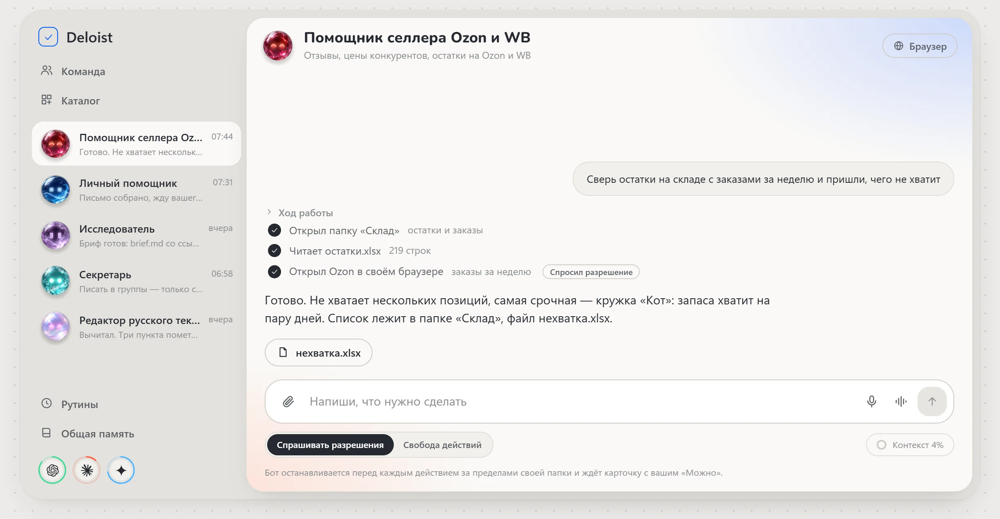
</picture>

## Что это

Deloist — программа для Windows, в которой живёт **команда ботов**, а не один ассистент. У каждого бота своя
роль, своя модель, своя папка и своя память. Боты работают в своём браузере и в ваших мессенджерах, запускаются
по расписанию и передают задачи друг другу. Всё, что может навредить — отправка людям, оплата, удаление,
публикация, — ждёт вашего «Можно».

Программа, боты и память лежат на вашем компьютере. Выбранная модель получает только то, что вы ей отправляете.

## Что умеет

- **Команда ботов.** Роли, группы ботов в одном чате, вызов нужного через `@`-упоминание. Готовые боты и навыки ставятся из каталога одной кнопкой.
- **Любые модели в одной команде.** ChatGPT, Claude, Gemini, DeepSeek, GigaChat, локальные Ollama и LM Studio, бесплатные тарифы. Одному боту — одна модель, соседу — другая.
- **Подписки, за которые вы уже платите.** ChatGPT, Claude, Gemini по своей подписке: видно, сколько осталось на 5 часов и на неделю. Упёрлась модель в лимит — бот переходит на запасную.
- **Карточка согласия.** Перед опасным действием бот останавливается и показывает, что именно собирается сделать: команду, сайт или файл как есть.
- **Правила для 51 мессенджера.** Telegram, WhatsApp, MAX, ВКонтакте и другие: для каждого действия выбираете «нельзя», «спросить» или «можно».
- **Свой браузер у бота.** Вы видите его экран и в любой момент берёте управление. Банки и Госуслуги закрыты всегда.
- **Рутины.** Задачи, напоминания и привычки по расписанию. Задачу можно написать фразой: «каждую среду вынести мусор».
- **Голос.** Распознавание речи на вашем компьютере без интернета, разговор без рук, «покажи на экране».
- **Память в Markdown.** Обычные файлы в вашей папке, открываются в Obsidian.
- **Док ботов** у края экрана и живые аватары — стеклянные шары, которые показывают, чем бот занят.

## Команда, где у каждого своя роль

Соберите ботов в один разговор. Позовите нужного `@`-упоминанием: он подхватит с того места, где остановился
предыдущий. В разработке: бот сам заметит задачу не по профилю и предложит позвать специалиста — только с вашего согласия.

<picture>
  <source media="(prefers-color-scheme: dark)" srcset="docs/images/team-ru-dark.webp">
  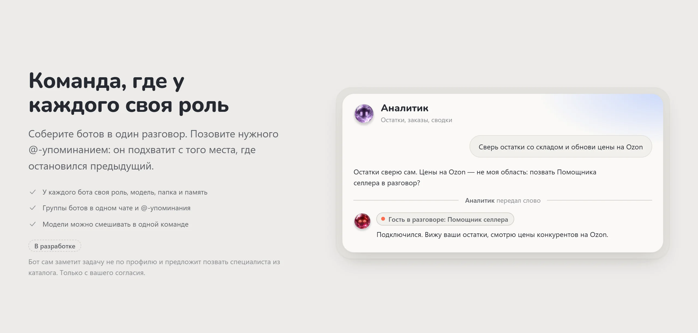
</picture>

## Разные ИИ в одной команде

У каждого бота своя модель. Боты пишут друг другу, передают задачи и файлы и проверяют результат друг за другом —
в одном окне, без переключения между сервисами.

<picture>
  <source media="(prefers-color-scheme: dark)" srcset="docs/images/models-ru-dark.webp">
  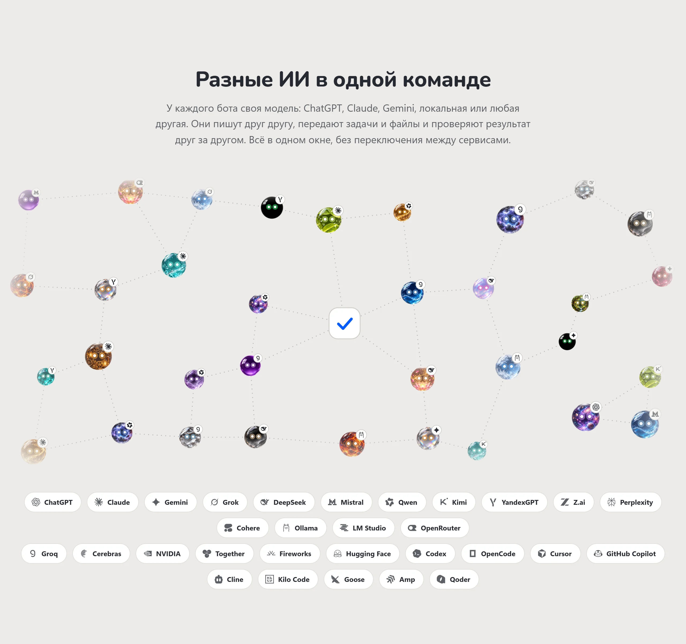
</picture>

<details>
<summary><b>С кем работает программа</b></summary>

<br>

| Тип | Провайдеры и агенты |
|---|---|
| Облачные модели | ChatGPT, Claude, Gemini, Grok, DeepSeek, Mistral, Qwen, Kimi, YandexGPT, GigaChat, Z.ai, Perplexity, Cohere |
| Агрегаторы и быстрые API | OpenRouter, Groq, Cerebras, NVIDIA, Together, Fireworks, Hugging Face |
| На вашем компьютере | Ollama, LM Studio |
| Агенты для кода | Codex, Claude Code, OpenCode, Cursor, GitHub Copilot, Cline, Kilo Code, Goose, Amp, Qoder |
| Свой адрес | любой OpenAI-совместимый эндпоинт |

</details>

## Рутины: повторяющиеся задачи идут сами

Опишите задачу один раз и скажите, когда её делать. Боты запускаются по расписанию, делят работу между собой
и приходят к вам только за разрешением. В тех же «Рутинах» — личные задачи, напоминания и привычки: даты,
время и повторы из фразы разбирает сама программа, без затрат на модель.

<picture>
  <source media="(prefers-color-scheme: dark)" srcset="docs/images/routines-ru-dark.webp">
  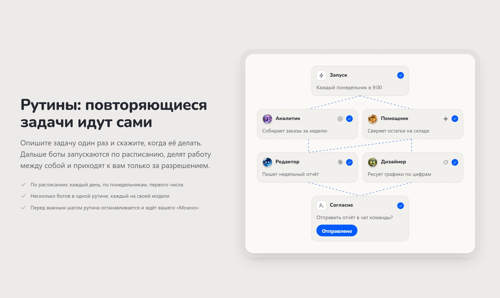
</picture>

## ИИ, который спросит, прежде чем рискнуть

Бот не удалит, не оплатит и не отправит письмо сам. Он остановится и покажет, что именно собирается сделать.

- **Видно, что произойдёт** — команда, сайт или файл как есть, а не пересказ.
- **Опасное запоминается отдельно** — обычное «всегда разрешать» не открывает оплату, отправку людям, удаление и публикацию.
- **Журнал решений** — что бот сделал по правилу или по вашему ответу, словами, в профиле бота.
- **Ночью — только правила** — в рутинах разрешения из разговора не действуют.

<picture>
  <source media="(prefers-color-scheme: dark)" srcset="docs/images/approvals-ru-dark.webp">
  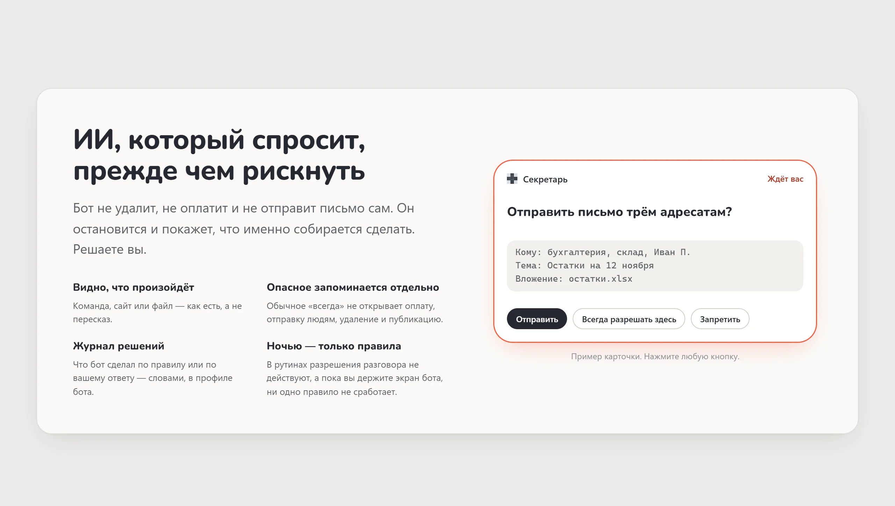
</picture>

## Правила для каждого мессенджера

Бот заходит в мессенджеры в своём браузере. Шесть действий — читать, вступать в группы, писать в группы,
писать в личку, отправлять файлы, удалять сообщения — и для каждого ваш выбор. Правила применяет сама
программа, а не бот: уговорить её словами нельзя.

<picture>
  <source media="(prefers-color-scheme: dark)" srcset="docs/images/messengers-ru-dark.webp">
  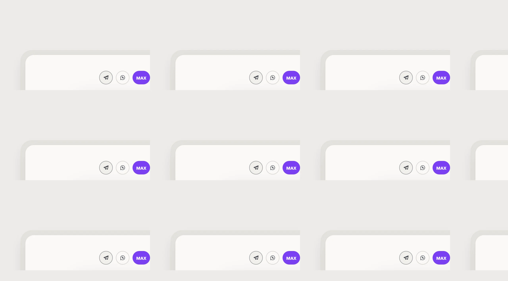
</picture>

## У бота свой браузер, и вы видите его экран

Бот ходит по сайтам в собственном окне. Нужен вход или капча — он сам зовёт вас. По желанию бот работает в
вашем Chrome, но только на сайтах, которые вы выбрали.

<picture>
  <source media="(prefers-color-scheme: dark)" srcset="docs/images/browser-ru-dark.webp">
  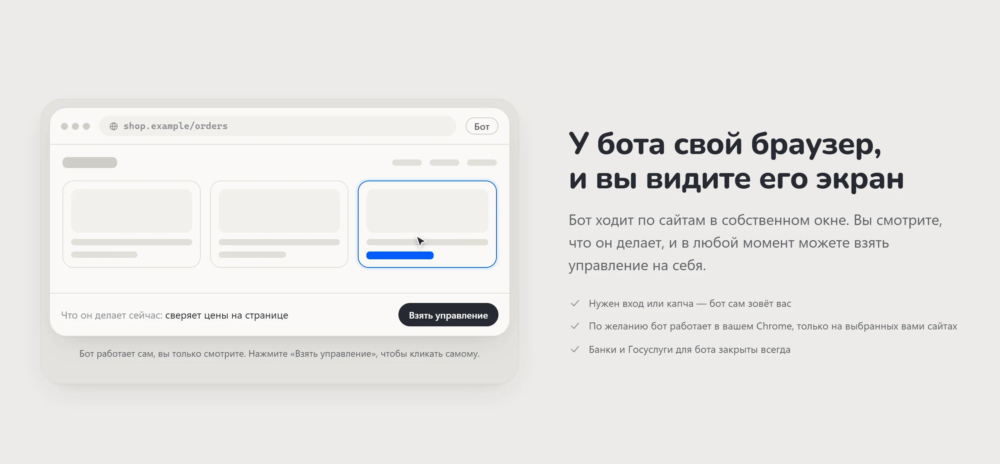
</picture>

## Подписки, за которые вы уже платите

Подключите ChatGPT, Claude или Gemini по своей подписке: видно, сколько осталось на 5 часов и на неделю.
Упёрлась модель в лимит — бот переходит на запасную.

<picture>
  <source media="(prefers-color-scheme: dark)" srcset="docs/images/limits-ru-dark.webp">
  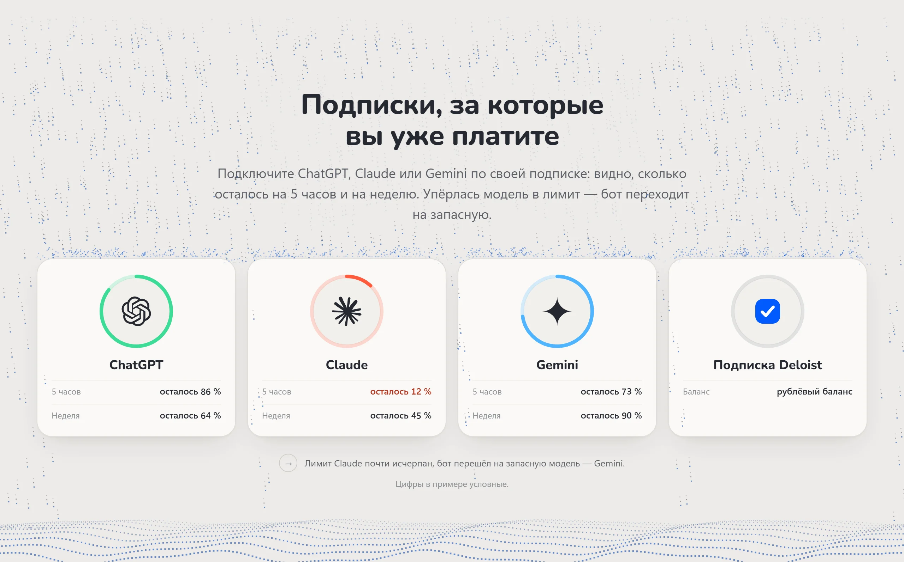
</picture>

## Говорите с ботом, не касаясь клавиатуры

- Голос боту по горячей клавише: речь распознаётся на вашем компьютере, без интернета и оплаты.
- Разговор без рук: бот отвечает голосом, его можно перебить.
- «Покажи на экране»: обведите область, снимок уйдёт боту вместе с вопросом.
- Правка выделенного текста по сочетанию клавиш в любой программе.

<picture>
  <source media="(prefers-color-scheme: dark)" srcset="docs/images/voice-ru-dark.webp">
  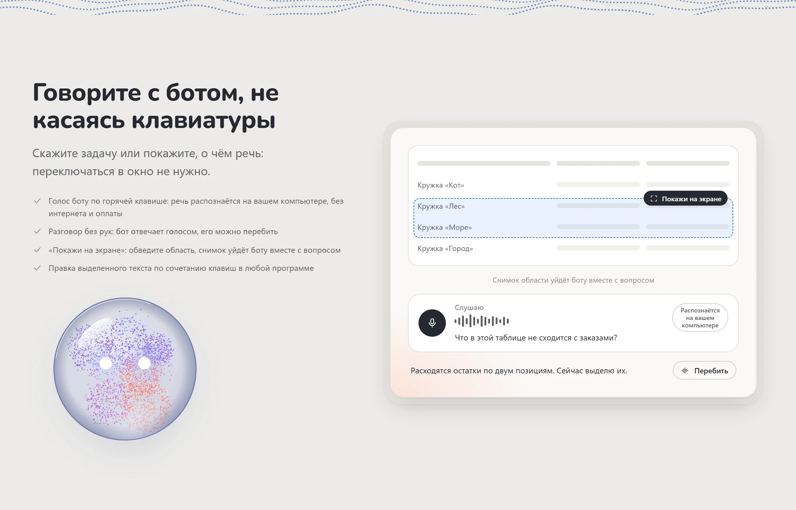
</picture>

## А ещё

<picture>
  <source media="(prefers-color-scheme: dark)" srcset="docs/images/also-ru-dark.webp">
  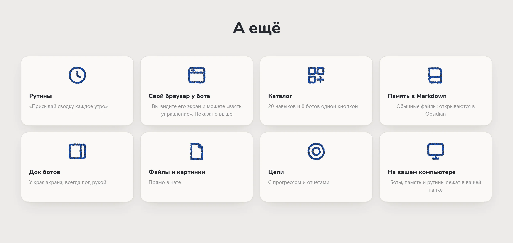
</picture>

### Живые аватары

Каждый бот — стеклянный шар со светящимися глазами. Их двадцать: Хрусталь, Волна, Рубин, Дымка, Иней, Золото,
Дым, Лагуна, Опал, Бирюза, Аметист, Обсидиан, Гроза, Лава, Космос, Лес, Механизм, Лотос, Лист и Ртуть.
По глазам видно, что происходит: значок загрузки — бот работает, знак вопроса — ждёт вашего решения,
звёзды — закончил, крестики — ошибка. Глаза следят за курсором, а через две минуты тишины бот засыпает.

<p align="center">
  
</p>

## Как это устроено

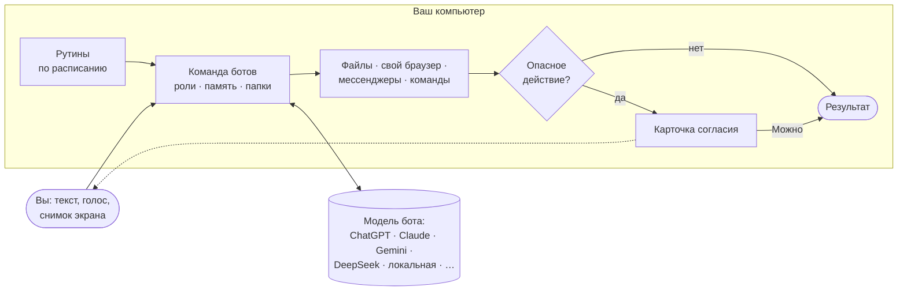

- Каждый бот получает свою папку. В ней он работает свободно; всё, что за её пределами, проходит через правила и карточки.
- Модель выбирается у каждого бота отдельно. Текст запроса уходит только провайдеру этой модели, а ключ каждого провайдера — только ему.
- Ключи хранятся зашифрованными средствами Windows.
- Окно можно закрыть: программа уходит в трей, боты и рутины продолжают работать.

## Установка

1. Скачайте [Deloist-Setup.exe](https://github.com/gordidima-rgb/deloist-agent/releases/latest/download/Deloist-Setup.exe) из последней версии.
2. Запустите его. Нужны Windows 10 или 11; WebView2, на котором работает окно, в Windows 11 уже есть.
3. Подключите модель: бесплатную, свою подписку или ключ, либо баланс Deloist.
4. Выберите готового бота в каталоге и дайте ему первую задачу словами или голосом.

Новые версии программа находит сама и ставит в одно нажатие. Каждая версия проверяется по цифровой подписи.
Для локального распознавания речи модель скачивается один раз, около 0,6 ГБ.

## Сколько это стоит

Программа бесплатная, без пробного периода и ограничений по времени. Платите только за модели, и только если
выбрали платные.

| Вариант | Цена | Что это |
|---|---|---|
| Бесплатные модели | 0 ₽ | Бесплатные тарифы NVIDIA, Groq, Google AI Studio, OpenRouter и Z.ai, а на своём компьютере — Ollama и LM Studio |
| Свой ключ или подписка | По тарифу провайдера | ChatGPT, Claude, Gemini, DeepSeek, GigaChat, «Алиса» и другие. Платите провайдеру напрямую |
| Подписка Deloist | Предоплаченный баланс | Пополняете от 100 ₽ на [deloist.ru](https://deloist.ru), запросы списываются с баланса. Без абонплаты. При первом входе — 100 ₽ в подарок |

<picture>
  <source media="(prefers-color-scheme: dark)" srcset="docs/images/pricing-ru-dark.webp">
  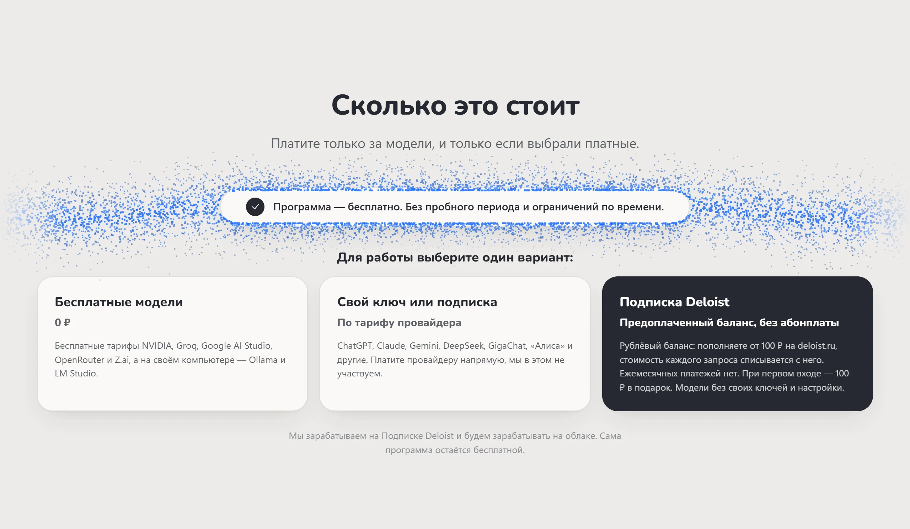
</picture>

## Скоро

Честно о том, чего ещё нет. Сроки могут сдвинуться.

| Статус | Что |
|---|---|
| В разработке | **Каталог специалистов** — боты узкой специализации: языки программирования, игровые движки, магазин на Ozon и WB, дизайн |
| В планах | **Боты пользователей** — делитесь своими ботами и навыками, после проверки они попадают в каталог с оценками |
| В планах | **Облако «всегда включено»** — боты работают на нашем сервере, пока ваш компьютер выключен |

## Вопросы и ответы

<details>
<summary><b>Куда уходят мои данные?</b></summary>

Боты, память и настройки хранятся в папке на вашем компьютере. Текст запроса получает только провайдер модели,
которую вы выбрали для бота. Ключ каждого провайдера хранится отдельно и уходит только ему.
</details>

<details>
<summary><b>Бот может что-то сломать?</b></summary>

В своей папке бот работает свободно. Изменить что-то вне её, удалить, оплатить, отправить людям или
опубликовать он может только после вашего разрешения. Кнопка «Стоп» останавливает ход в любой момент.
</details>

<details>
<summary><b>Нужно ли уметь программировать?</b></summary>

Нет. Готовых ботов и навыки ставят из каталога одной кнопкой, а задачи дают словами или голосом.
</details>

<details>
<summary><b>А на Mac или Linux?</b></summary>

Пока только Windows.
</details>

## Сборка из исходников

Deloist написан на Rust, окно работает на WebView2, интерфейс — обычный JS и Svelte 5.

Нужен только [rustup](https://rustup.rs). Точный тулчейн (`stable-x86_64-pc-windows-gnullvm`) указан в
`rust-toolchain.toml` и несёт свой линкер, поэтому Visual Studio, MSYS2 и C-компилятор не нужны.

```bash
git clone https://github.com/gordidima-rgb/deloist-agent.git
cd deloist-agent
cargo build --release        # target/release/deloist.exe
cargo build --examples       # тестовые заглушки агентов, нужны тестам
cargo test                   # все тесты
```

Собранный интерфейс на Svelte лежит в `web/ui/`, поэтому хватает `cargo build`. Чтобы менять сам интерфейс:

```bash
cd ui
npm ci
npm run build                # пересобирает web/ui/ и проверяет, что сборка свежая
npm test
```

Отладочной сборке не нужен аккаунт Deloist, а демо-режим прогоняет весь контур — инструменты, согласия,
папки, разговоры — без настоящей модели. Данные лежат в `data/` рядом с репозиторием или exe; другую папку задаёт
`CREW_DATA_DIR`.

| Папка | Что там |
|---|---|
| `src/` | программа: сервер, боты, драйверы моделей, инструменты, согласия, браузер, рутины |
| `web/`, `ui/` | интерфейс: экраны на JS и компоненты на Svelte 5 |
| `catalog/` | готовые боты и навыки из каталога |
| `tests/` | интеграционные тесты, в том числе набор защиты |
| `extension/` | расширение Chrome для работы в вашем браузере |
| `THIRD_PARTY/` | лицензии кода и ресурсов из других проектов |

> [!NOTE]
> **Открытое ядро.** Нескольких частей официальной сборки в репозитории нет: аккаунта и Подписки Deloist,
> полного каталога (в репозитории — несколько ботов и навыков для примера) и стеклянных шаров-аватаров.
> Без них программа использует встроенные заглушки — у ботов цветной кружок с инициалом — и полностью
> работает с вашими моделями и ключами.

## Участие

Сообщения об ошибках, идеи и pull request'ы приветствуются.

- [Сообщить об ошибке](../../issues/new?template=bug.yml)
- [Предложить улучшение](../../issues/new?template=idea.yml)
- Вопрос или обсуждение — [Telegram](https://t.me/deloist_app) или support@deloist.com

Перед pull request'ом прогоните `cargo test` (и `npm test` в `ui/`, если трогали интерфейс). Новый адрес API,
который меняет команды, адреса, ключи или согласия, должен быть доступен только человеку и получить тест в
`tests/security.rs`. Отправляя изменения, вы даёте правообладателю бессрочную бесплатную лицензию использовать, менять и
распространять их по PolyForm Noncommercial 1.0.0 и по любой другой лицензии, в том числе на условиях
официальных сборок.

> [!IMPORTANT]
> Задачи здесь видны всем. Перед отправкой уберите из текста и снимков ключи, пароли и личные данные.
> О проблемах безопасности пишите на support@deloist.com, а не в открытую задачу.

## Лицензия

Исходный код открыт для чтения по [PolyForm Noncommercial License 1.0.0](LICENSE): его можно читать, запускать,
менять и делиться изменениями в любых некоммерческих целях — для себя, учёбы, исследований, хобби, в
благотворительных, учебных и государственных организациях. Делать на этом коде коммерческий продукт или
сервис и продавать его без отдельной лицензии нельзя. Коммерческая лицензия — по почте support@deloist.com.

**Официальные сборки из [Releases](https://github.com/gordidima-rgb/deloist-agent/releases) бесплатны для
любого использования, в том числе в бизнесе**, по [условиям Deloist](https://deloist.ru/legal/offer).
Некоммерческое ограничение касается исходного кода и сборок, которые вы делаете из него сами.

Код и ресурсы из других проектов остаются под своими лицензиями: см. [NOTICE](NOTICE) и
[`THIRD_PARTY/`](THIRD_PARTY). «Deloist» и логотип Deloist — товарные знаки владельца, использовать их в
других продуктах нельзя. Снимки и картинки в `docs/images/` под лицензию не подпадают.

<br>

<div align="center">
<sub>© 2026 Deloist · <a href="https://deloist.ru">deloist.ru</a> · Логотипы провайдеров принадлежат их владельцам и приведены только для названия</sub>
</div>
